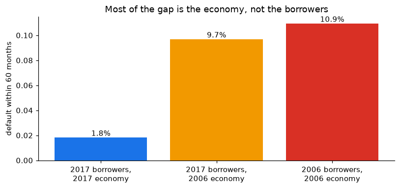
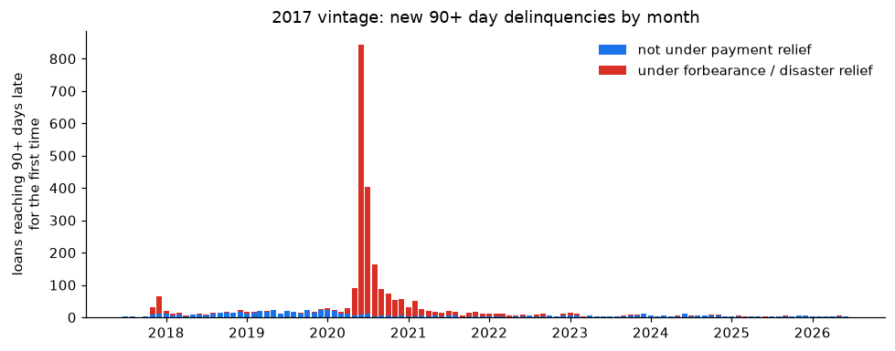
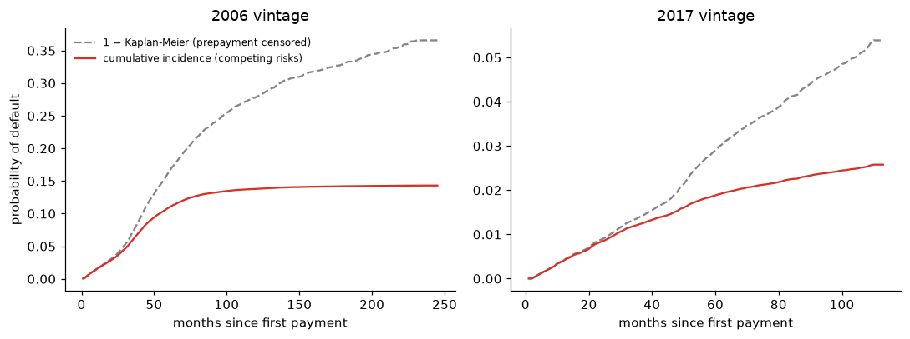
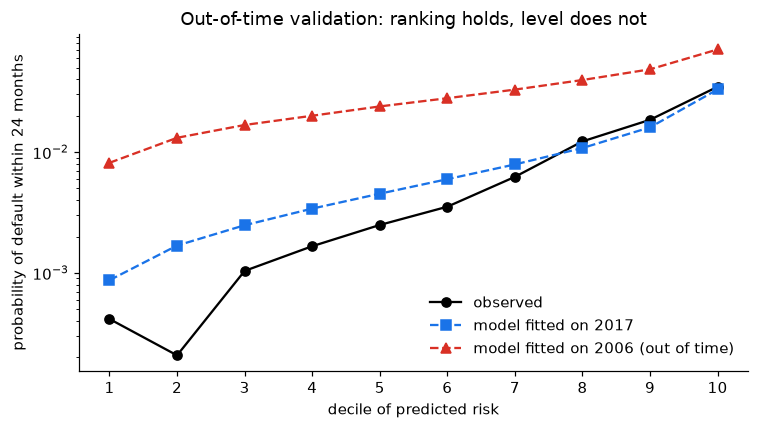
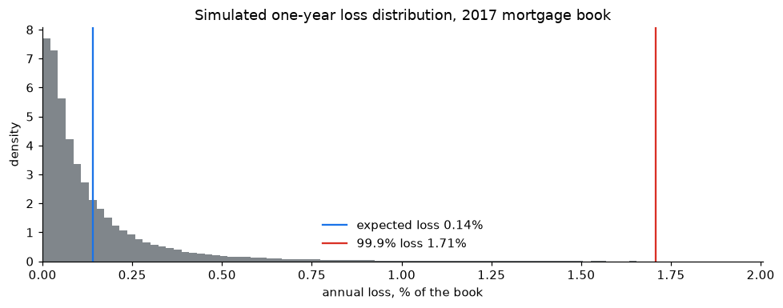

# Why did 2006 mortgages default almost six times more than 2017 ones?

**Credit-risk modelling on 100,000 US mortgages followed for up to 20 years: competing-risks survival, a Cox model validated out of time, a scorecard against XGBoost, LightGBM and a neural network, borrower segmentation, and a Monte Carlo of portfolio losses checked against the Basel capital formula.**

📊 [Full report](https://amaugomez.github.io/mortgage-credit-risk/) · Python (pandas, lifelines, scikit-learn, XGBoost, LightGBM, SHAP, SciPy) · SQL (DuckDB) · Data: [Freddie Mac Single-Family Loan-Level Dataset](https://freddiemac.com/research/datasets/sf-loanlevel-dataset)

---

## The answer

Two random samples of 50,000 thirty-year fixed-rate mortgages, originated in **2006** (just before the housing crisis) and **2017**, each followed month by month until it was repaid, defaulted, or the data ended (June 2026).

| | 2006 vintage | 2017 vintage |
|---|---|---|
| Defaulted (90+ days late, excluding payment relief) | **14.3%** | **2.5%** |
| Default probability within 60 months (competing risks) | 10.9% | 1.9% |
| Loss per defaulted dollar | 26.6% | 0.7% |

**About 86% of the gap is the economy, not the borrowers.** Giving the 2006 book the safer 2017 mix of borrowers barely lowers its default rate (10.9% → 9.7%), and a Cox model that adjusts for credit score, leverage, debt-to-income, pricing and loan purpose still finds that an otherwise identical 2006 loan had **4.6 times** the default hazard. Two different methods, one conclusion.

## Two traps that would have produced the wrong answer

**1. In 2020, "90 days late" did not mean default.** Applying the standard 90-days-past-due definition blindly more than doubles the 2017 default rate (5.9% instead of 2.5%), because millions of borrowers were in COVID-19 forbearance. Only 30% of the loans whose first serious delinquency happened under forbearance ever defaulted. A model trained on the naive definition would learn that "2020 borrowers were risky" when what happened was a policy.

**2. Treating prepayment as censoring nearly doubles the default probability.** Most mortgages leave the book by prepayment, and a refinanced loan cannot default. The usual 1 − Kaplan-Meier estimate puts the 100-month default probability of the 2006 vintage at 25.5%; the competing-risks (Aalen-Johansen) estimate is 13.5%.

## Validation: ranking transfers across time, the level of risk does not

A Cox model fitted on the 2006 vintage ranks 2017 borrowers almost as well as a model fitted on 2017 itself (concordance 0.778 vs 0.790), but it overstates their probability of default several times over. Discrimination is a property of borrowers; calibration depends on the cycle. That is why banks keep ranking models and recalibrate their level.

The proportional-hazards checks are findings, not nuisances: the extra risk of a 2006 loan peaked in months 25–48 of its life (2008–2010), and the predictive power of origination information fades as loans age. Residual diagnostics (scaled Schoenfeld, martingale, Cox-Snell, deviance) show where the model falls short: the credit score acts non-linearly, and a constant vintage effect overstates the accumulated risk of long-lived 2006 loans.

## Scorecard vs machine learning

A bank-style scorecard (weights of evidence, information value, logistic regression, points table) against XGBoost, LightGBM (also with monotone constraints) and a neural network, all fitted on 2006 loans to predict default within three years:

| Model | Gini, 2006 test | Gini, 2017 (out of time) | PSI |
|---|---|---|---|
| Scorecard (logistic + WoE) | 0.53 | 0.53 | 0.05 |
| XGBoost | 0.55 | 0.53 | 0.06 |
| LightGBM | 0.54 | 0.53 | 0.05 |
| Neural network | 0.56 | 0.46 | 0.12 |

Machine learning ranks loans slightly better in time (at most about one AUC point) and not at all out of time; the neural network loses almost 4 AUC points on 2017 loans. Every model overpredicts 2017 default about fourfold. SHAP values show the boosting model learned the scorecard's story by itself. With a few strong variables, the scorecard wins on auditability at equal accuracy.

## Portfolio losses and capital

A one-factor (Vasicek) model of correlated defaults, calibrated on the 2017 book with a crisis-level loss given default:

- Monte Carlo and the closed-form Basel formula give the same 99.9% loss (1.71% vs 1.75% of the book).
- **Importance sampling** estimates the 1-in-1,000 tail probability with **~290 times less variance** than plain Monte Carlo for the same number of simulations.
- **MCMC (Metropolis–Hastings, written from scratch):** the posterior of the default correlation from 27 yearly default rates has median 0.04 (95% credible interval 0.02–0.07), with four chains, R-hat = 1.000 and thousands of effective draws.
- The worst crisis year of the 2006 vintage (2010: 4.4% of loans defaulted) corresponds, with the Basel correlation of 0.15, to roughly a once-in-200-years economy; the 99.9% capital level (6.7%) would have covered it. The conclusion is sensitive to the correlation, and a correlation estimated from the data depends on whether the crisis is treated as part of the cycle or absorbed into each period's PD.

## Notebooks

| | Notebook | What it does |
|---|---|---|
| 1 | [Data and the definition of default](notebooks/01_data_and_default_definition.ipynb) | SQL pipeline, outcomes, the forbearance trap, loss given default |
| 2 | [Survival with competing risks](notebooks/02_survival_competing_risks.ipynb) | Aalen-Johansen vs Kaplan-Meier, default and prepayment curves, default by credit score |
| 3 | [Cox model](notebooks/03_cox_model.ipynb) | Hazard ratios, proportional-hazards test, residual diagnostics, effects by loan age, out-of-time validation |
| 4 | [Segmentation](notebooks/04_segmentation.ipynb) | PCA, k-means, composition vs environment decomposition |
| 5 | [Portfolio loss simulation](notebooks/05_portfolio_loss_simulation.ipynb) | Vasicek Monte Carlo, Basel check, importance sampling, crisis tail probability, correlation by maximum likelihood and by MCMC |
| 6 | [Scorecard vs machine learning](notebooks/06_pd_models_ml.ipynb) | WoE/IV scorecard and points, XGBoost, LightGBM (monotone), neural network, AUC/Gini/KS, bootstrap, calibration, PSI, SHAP |

Code: [`src/credit_risk/data.py`](src/credit_risk/data.py) builds one row per loan with SQL run by DuckDB directly on the raw files; [`src/credit_risk/survival.py`](src/credit_risk/survival.py) implements the discrete-time competing-risks estimator (checked against `lifelines`).

## Data and reproducibility

The data are **not included**: Freddie Mac's terms allow publishing research results, but not the dataset or extracts of it. Everything in this repository is aggregated; no individual loan is shown.

1. Register (free) at Freddie Mac's [Clarity Data Intelligence](https://freddiemac.com/research/datasets/sf-loanlevel-dataset) and download `sample_2006.zip` and `sample_2017.zip` from the Single-Family Loan-Level Dataset page.
2. Unzip them into one folder and point `FREDDIE_DIR` to it (default: `~/Downloads/freddie`).
3. `pip install -r requirements.txt`, then run the notebooks in order. Building the loan-level tables takes a few seconds.

*Freddie Mac provides the dataset "as is" and does not endorse this analysis.*

## Skills shown

Survival analysis with competing risks · Cox proportional hazards and residual diagnostics · out-of-time model validation (discrimination vs calibration) · PCA and clustering · Monte Carlo simulation, importance sampling and MCMC · Vasicek / Basel IRB capital · maximum likelihood · SQL (DuckDB) · Python

---

Code: MIT License. Aaron Mauricio Gómez Jiménez · [LinkedIn](https://www.linkedin.com/in/amaugomezjimenez) · [ORCID](https://orcid.org/0009-0003-1099-0431)
