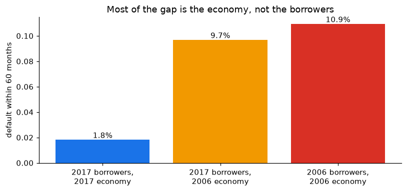
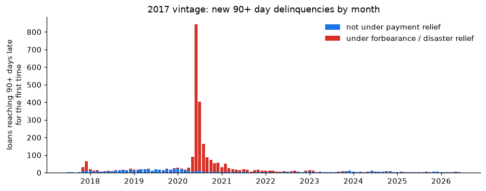
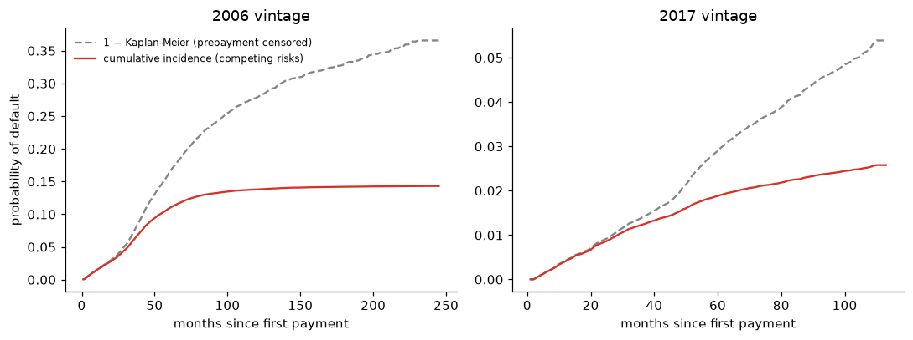
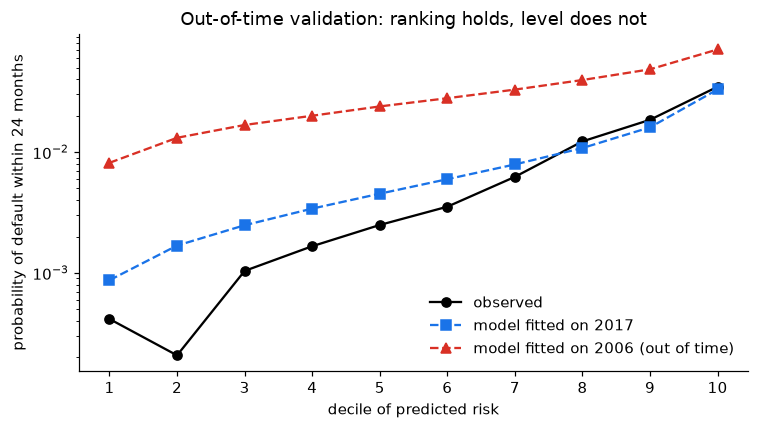
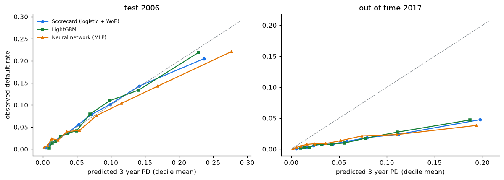
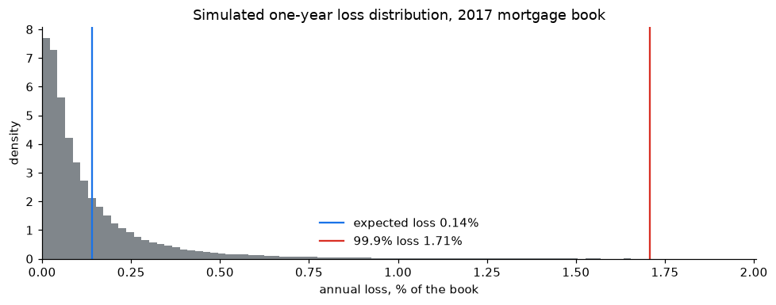

**November 2026** · Python (pandas, lifelines, scikit-learn, XGBoost, LightGBM, SHAP, SciPy) and SQL (DuckDB) · [Code and notebooks](https://github.com/AMauGomez/mortgage-credit-risk) · Data: [Freddie Mac Single-Family Loan-Level Dataset](https://freddiemac.com/research/datasets/sf-loanlevel-dataset)

```{=html}
<style>
.flow{display:flex;flex-wrap:wrap;gap:.6rem;margin:1.2rem 0 .4rem;align-items:stretch}
.flow .step{flex:1 1 160px;border:1px solid #dadce0;border-radius:10px;padding:.75rem .8rem;background:#fafbfc}
.flow .step .n{font-size:.72rem;letter-spacing:.06em;text-transform:uppercase;color:#5f6368}
.flow .step .big{font-size:1.35rem;font-weight:700;line-height:1.15;margin:.2rem 0}
.flow .step .txt{font-size:.85rem;color:#3c4043;line-height:1.3}
.flow .step.hl{border-color:#1a73e8;background:#e8f0fe}
</style>
<div class="flow">
 <div class="step"><div class="n">Data</div><div class="big">100,000</div><div class="txt">30-year fixed-rate mortgages, 2006 and 2017 vintages, followed monthly to June 2026</div></div>
 <div class="step"><div class="n">Default rate</div><div class="big">14.3% vs 2.5%</div><div class="txt">2006 vs 2017, excluding COVID-19 payment relief</div></div>
 <div class="step hl"><div class="n">Why</div><div class="big">86% economy</div><div class="txt">of the gap is the environment; 14% is the mix of borrowers</div></div>
 <div class="step hl"><div class="n">Validation</div><div class="big">0.78</div><div class="txt">out-of-time concordance: a 2006 model still ranks 2017 borrowers, but overstates their risk</div></div>
</div>
```

## The question

Mortgages originated in 2006, just before the US housing crash, defaulted almost six times more than mortgages originated in 2017. Were 2006 borrowers simply riskier, or did ordinary borrowers meet an extraordinary economy? The answer decides how a bank should build and recalibrate its credit models.

Two random samples of 50,000 loans each come from Freddie Mac's public loan-level data. Every loan is followed month by month until it is repaid, defaults, or the data end.

## The answer: mostly the economy

Giving the 2006 book the safer 2017 mix of borrowers barely lowers its default rate (10.9% → 9.7% within 60 months). A Cox model that adjusts for credit score, leverage, debt-to-income, pricing and loan purpose reaches the same conclusion by a different route: an otherwise identical 2006 loan had **4.6 times** the default hazard.



## Two traps that would have produced the wrong answer

**In 2020, "90 days late" did not mean default.** The standard 90-days-past-due definition, applied blindly, more than doubles the 2017 default rate (5.9% instead of 2.5%), because borrowers in COVID-19 forbearance were reported as delinquent. Only 30% of the loans whose first serious delinquency happened under forbearance ever defaulted.



**Treating prepayment as censoring nearly doubles the default probability.** Most mortgages leave the book by prepayment, and a refinanced loan cannot default. The usual 1 − Kaplan-Meier estimate puts the 100-month default probability of the 2006 vintage at 25.5%; the competing-risks (Aalen-Johansen) estimate is 13.5%.



## Validating the model

- **Out of time:** a Cox model fitted on the 2006 vintage ranks 2017 borrowers almost as well as a model fitted on 2017 itself (concordance 0.778 vs 0.790) but overstates their probability of default several times over. Discrimination transfers across the cycle; calibration does not.
- **Residual diagnostics:** scaled Schoenfeld residuals show that origination information ages (the credit-score effect loses about two thirds of its size over the life of a loan); martingale residuals show the credit score acts non-linearly; Cox-Snell residuals show the model overstates the accumulated risk of its riskiest loans, consistent with a vintage effect that changes over time.



## Scorecard vs machine learning

A bank-style scorecard (weights of evidence, logistic regression, points table) is compared with XGBoost, LightGBM (also with monotone constraints) and a neural network, all fitted on 2006 loans to predict default within three years:

| Model | Gini, 2006 test | Gini, 2017 (out of time) | PSI |
|---|---|---|---|
| Scorecard (logistic + WoE) | 0.53 | 0.53 | 0.05 |
| XGBoost | 0.55 | 0.53 | 0.06 |
| LightGBM | 0.54 | 0.53 | 0.05 |
| Neural network | 0.56 | 0.46 | 0.12 |

- Machine learning ranks loans slightly better **in time** (at most about one AUC point) and **not at all out of time**; the neural network loses almost 4 AUC points on 2017 loans (bootstrap interval −0.047 to −0.025).
- Every model overpredicts 2017 default about fourfold: no algorithm recovers information the origination data do not contain.
- SHAP values show the boosting model learned the scorecard's story by itself (credit score, LTV steps at 80% and 90%, debt-to-income). With a few strong variables, the scorecard wins on auditability at equal accuracy.



## Portfolio losses and capital

A one-factor (Vasicek) model of correlated defaults, calibrated on the 2017 book with a crisis-level loss given default:

- Monte Carlo and the closed-form Basel formula give the same 99.9% loss (1.71% vs 1.75% of the book).
- **Importance sampling** estimates the 1-in-1,000 tail with about 290 times less variance than plain Monte Carlo.
- **MCMC (Metropolis–Hastings, written from scratch)** gives the posterior of the default correlation: median 0.04, 95% credible interval 0.02–0.07, four chains with R-hat = 1.000.
- The worst crisis year of the 2006 vintage (2010, 4.4% of loans defaulting) corresponds, with the Basel correlation of 0.15, to roughly a once-in-200-years economy; the 99.9% level would have covered it.



## The notebooks

| | Notebook | What it does |
|---|---|---|
| 1 | [Data and the definition of default](notebooks/01_data_and_default_definition.html) | SQL pipeline, outcomes, the forbearance trap, loss given default |
| 2 | [Survival with competing risks](notebooks/02_survival_competing_risks.html) | Aalen-Johansen vs Kaplan-Meier, default and prepayment curves, default by credit score |
| 3 | [Cox model](notebooks/03_cox_model.html) | Hazard ratios, proportional-hazards test, residual diagnostics, effects by loan age, out-of-time validation |
| 4 | [Segmentation](notebooks/04_segmentation.html) | PCA, k-means, composition vs environment |
| 5 | [Portfolio loss simulation](notebooks/05_portfolio_loss_simulation.html) | Vasicek Monte Carlo, Basel check, importance sampling, crisis tail probability, correlation by maximum likelihood and by MCMC |
| 6 | [Scorecard vs machine learning](notebooks/06_pd_models_ml.html) | WoE/IV scorecard and points, XGBoost, LightGBM (monotone), neural network, AUC/Gini/KS, bootstrap, calibration, PSI, SHAP |

## Data

The data are **not included** in the repository: Freddie Mac's terms allow publishing research results but not the dataset or extracts of it. Everything shown is aggregated; no individual loan appears. Instructions to reproduce are in the [README](https://github.com/AMauGomez/mortgage-credit-risk#data-and-reproducibility). Freddie Mac provides the dataset "as is" and does not endorse this analysis.

**Skills shown:** survival analysis with competing risks · Cox proportional hazards and residual diagnostics · out-of-time model validation · PCA and clustering · Monte Carlo simulation, importance sampling and MCMC · Vasicek / Basel IRB capital · maximum likelihood · SQL (DuckDB) · Python

---

Code: MIT License. Aaron Mauricio Gómez Jiménez · [LinkedIn](https://www.linkedin.com/in/amaugomezjimenez) · [ORCID](https://orcid.org/0009-0003-1099-0431)
